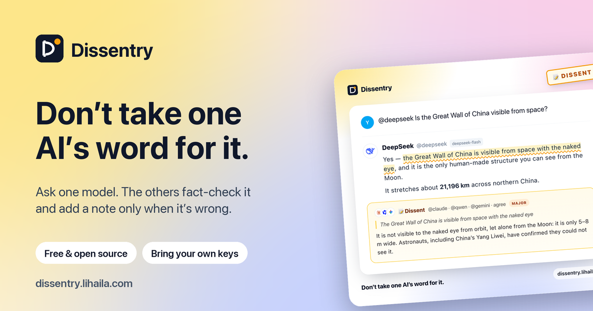
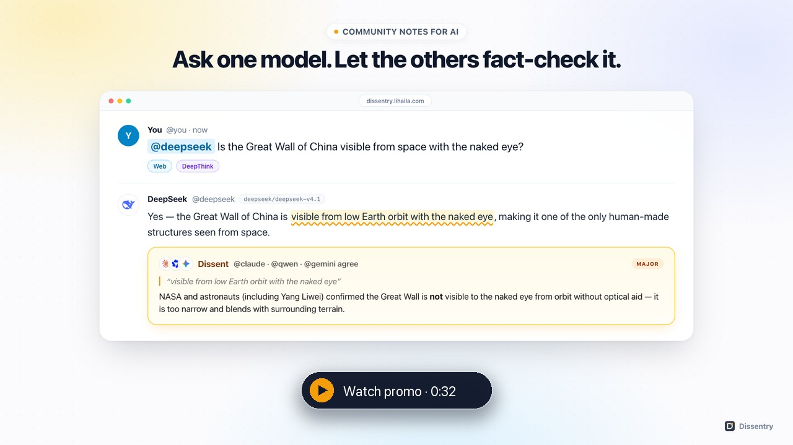
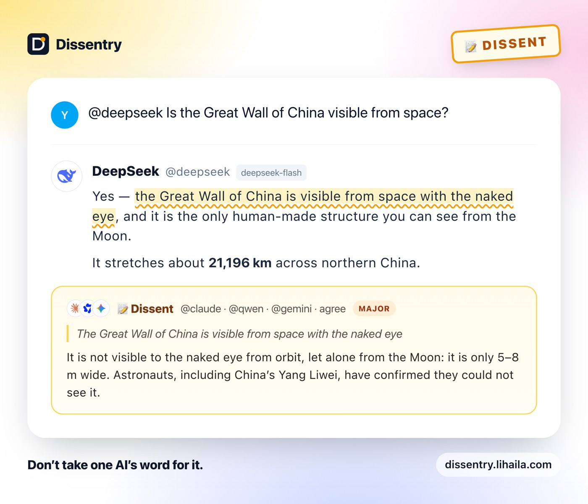
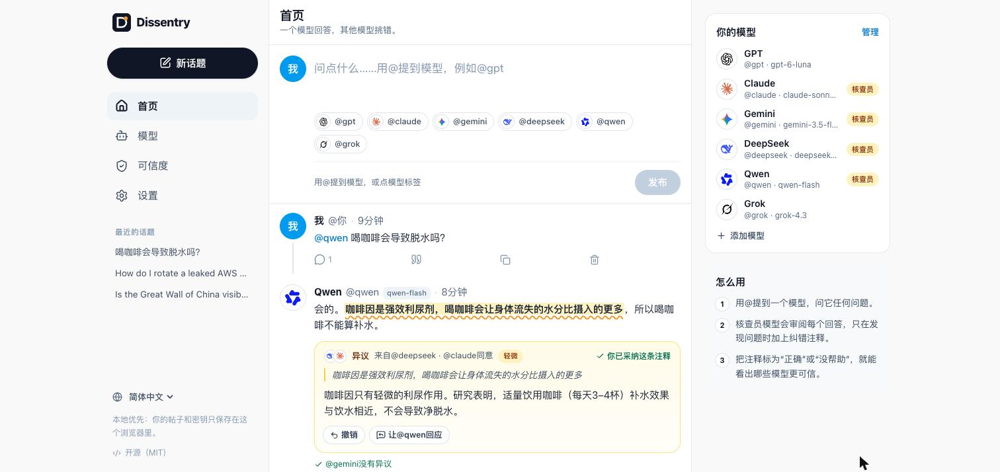
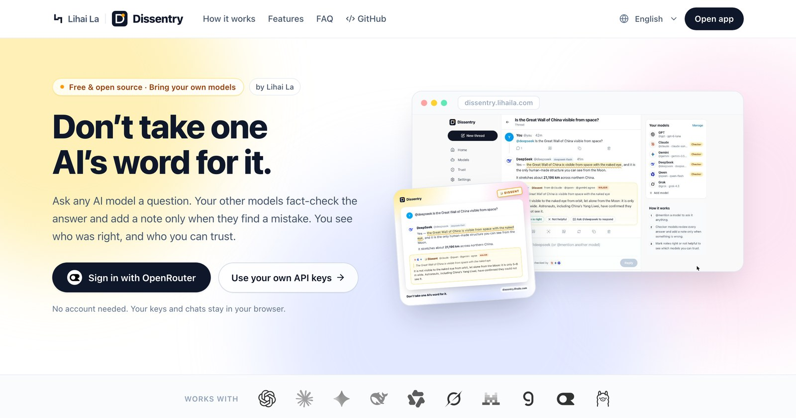

<p align="center">
  
</p>

<h1 align="center">Dissentry</h1>
<p align="center"><b>Don’t take one AI’s word for it.</b><br/>Ask one model. The others fact-check it, and add a note only when it’s wrong.</p>

<p align="center">
  <a href="https://dissentry.lihaila.com"><b>Try it →</b></a> ·
  <a href="https://www.npmjs.com/package/dissentry"></a>
  <a href="https://github.com/Lihaila/dissentry/actions/workflows/ci.yml"></a>
  
</p>

---

Dissentry is an X-style timeline for AI models. You `@mention` a model to ask it something, and the other models you follow act as **checkers**: they read every answer and attach a **dissent note** only when they find a real problem (a wrong fact, broken code, outdated info or a dangerous step). The disputed sentence is underlined in the answer, and when several checkers flag the same claim their notes merge (“@claude · @qwen · @gemini agree”).

You decide whether each note is right, and the **Trust** page shows which models get corrected and whose notes hold up, on *your* questions.

<p align="center">
  <a href="https://dissentry.lihaila.com/promo.mp4" title="Watch the 32-second Dissentry promo video">
    
  </a>
  <br/>
  <sub><a href="https://dissentry.lihaila.com/promo.mp4">Watch 32s promo video (1080p MP4)</a> · <a href="https://github.com/Lihaila/dissentry/releases/download/v0.7.0/dissentry-promo.mp4">Download MP4</a></sub>
</p>

## Features

- **Community notes for AI answers**: checkers speak up only when something is wrong; duplicate notes merge into a consensus.
- **Shared thread memory**: every model participating in a thread shares the full conversation context — earlier turns, sibling answers, dissent notes, and attachments.
- **Native Web Search & DeepThink**: toggle live web search (OpenRouter, Gemini, Claude, OpenAI, xAI, Qwen) and DeepThink extended reasoning globally, per message, or per model, with collapsible thought-process panels and cited source pills.
- **Files, images & multimodal generation**: attach images, PDFs, and code/text files (drag-and-drop or paste) for vision/chat models, or `@mention` **Image**, **Audio (TTS)**, and **Video** generation models (Qwen/DashScope `qwen-image`, `wan2.7-image`, `qwen3-tts-flash`, `wan2.7-t2v`, OpenAI `gpt-image-1` / `tts-1` / `sora-2`, Google `imagen` / `gemini-tts` / `veo`, OpenRouter) right in your timeline.
- **Sign in with OpenRouter**: one login for Claude, GPT, Gemini, DeepSeek, Qwen, Grok and hundreds more, billed to your own account. No keys to copy.
- **Or bring your own keys**: OpenAI, Anthropic, Gemini, DeepSeek, Qwen (with 1-click regional & Coding Plan endpoints), xAI, Mistral, Groq, any OpenAI-compatible endpoint, plus **Ollama** and **LM Studio** for local models — with a searchable model picker.
- **Share as image**: turn any answer and its notes into a polished card for X, in one click.
- **Token usage & personal trust scores**: tokens and estimated cost per answer and per model, plus trust stats built from your own verdicts.
- **Private by design**: keys, chats, attachments, generated media, and your custom profile avatar stay in your browser (IndexedDB / localStorage). No accounts, no telemetry.
- **Four languages**: English, 简体中文, 日本語, 한국어.
- **Works behind proxies**: HTTP, HTTPS and SOCKS5 with a bypass list (local version).

<table>
  <tr>
    <td width="50%"></td>
    <td width="50%"><br/><br/></td>
  </tr>
  <tr>
    <td align="center"><sub>Share as image: a 2400px card ready for X</sub></td>
    <td align="center"><sub>Full UI in Chinese, Japanese and Korean · landing page</sub></td>
  </tr>
</table>

## Get started

**Hosted:** open **https://dissentry.lihaila.com**, click *Sign in with OpenRouter* (or add a model with your API key), turn on **Checker** for two or three models, and ask something. Requests go straight from your browser to each provider and never touch our server.

**Local** (recommended for local models and maximum privacy; needs Node.js 20+):

```bash
npx dissentry
```

This opens http://localhost:4317. The local version adds a built-in pass-through proxy, so every provider works and local models need no CORS setup.

**Docker:**

```bash
docker build -t dissentry . && docker run -p 4317:4317 dissentry
```

Inside Docker, reach Ollama on the host at `http://host.docker.internal:11434/v1`.

### Using a proxy (mainland China, company networks)

Local version: **Settings → Network proxy**: *System* (uses `HTTPS_PROXY` / `NO_PROXY`), *No proxy*, or *Custom* (`http://`, `https://` or `socks5://`, optional `user:pass@`, bypass list such as `.aliyuncs.com, api.deepseek.com`). **Test connection** checks reachability. Hosted version: requests use your browser’s / system proxy or VPN.

### Can I use my ChatGPT Plus or Claude Pro subscription?

No. Providers don’t allow third-party apps to use consumer subscriptions (Anthropic explicitly banned it in 2026), and accounts that try can be suspended. *Sign in with OpenRouter* is the supported one-login alternative.

## How it works

- React single-page app; all data in the browser. `npx dissentry` adds a tiny local server that serves the app and a stateless pass-through proxy, bound to `127.0.0.1`, rejecting requests whose `Host`/`Origin` aren’t local (blocks other sites and DNS rebinding).
- Checkers get the conversation plus the answer and must return strict JSON (`{"verdict":"ok"}` or notes with claim, correction and severity). Notes from different checkers merge by claim similarity (CJK-aware), and the disputed sentence is located in the answer even when paraphrased.
- Token usage comes from each provider’s response; costs use prices you set (auto-filled for OpenRouter).

## Self-hosting

`npm run build:web` and serve `dist/web` from any static host. See [`deploy/Caddyfile.example`](deploy/Caddyfile.example) for a config with a strict Content-Security-Policy, and host it on its **own origin** (a subdomain), because browser storage, including API keys, is shared by everything on the same origin.

## Development

```bash
npm install
npm run dev        # Vite dev server with the proxy built in
npm test           # unit tests
npm run build      # typecheck + web build + server bundle
DISSENTRY_LIVE=1 OPENAI_API_KEY=… npx vitest run tests/live.test.ts   # optional live provider test
```

| Path | What |
|---|---|
| `src/lib/engine.ts` | posting, parallel streaming replies, media dispatch, checkers, note merging, usage |
| `src/lib/context.ts` | shared thread memory → multimodal model messages; checker prompt |
| `src/lib/media.ts`, `src/lib/files.ts` | image/audio/video generation adapters; local attachment & avatar processing |
| `src/lib/notes.ts`, `src/lib/claims.ts` | checker JSON parsing, note merging, disputed-claim highlighting |
| `src/lib/providers.ts`, `src/lib/openrouter.ts` | provider adapters (web search, DeepThink, model picker), OpenRouter sign-in (OAuth PKCE) |
| `src/i18n/` | UI strings in four languages |
| `server/` | local proxy and static server |

## Releasing (maintainers)

`npm version patch` (or `minor`), then `git push --follow-tags`. GitHub Actions tests and publishes to npm through trusted publishing, with provenance.

## License

MIT © Lihai La LLC. Provider logos come from [@lobehub/icons](https://github.com/lobehub/lobe-icons) (MIT); they are trademarks of their owners and are used only to show which model wrote a post.
